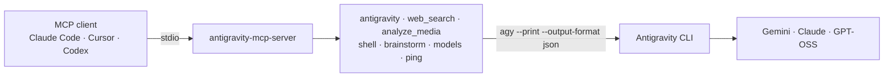

# Antigravity MCP Server

[](https://github.com/vanh1011/antigravity-mcp-server/actions/workflows/ci.yml)
[](LICENSE)
[](package.json)

Put Antigravity to work from inside your editor.

This server wraps the Antigravity CLI (`agy`) so any MCP client can call it as a tool. From Claude Code, Claude Desktop, Cursor or Codex you can hand Antigravity a task to carry out, ask for a review, read a screenshot or PDF, search the web, or brainstorm. The work runs on your Antigravity plan, not on the client's.



## Getting started

### 1. Make sure `agy` works on its own

You need Node.js 20 or newer and the Antigravity CLI, signed in.

```bash
agy -p "say pong" --output-format json
```

If that prints a JSON object with `"status":"SUCCESS"`, you are ready. If not, see [Working with the Antigravity CLI](docs/antigravity-cli.md).

### 2. Add the server to your client

The package installs straight from GitHub. It is not on npm yet.

**Claude Code**

```bash
claude mcp add antigravity -s user -- npx -y github:vanh1011/antigravity-mcp-server
```

<details>
<summary><b>Claude Desktop</b></summary>

Edit `~/Library/Application Support/Claude/claude_desktop_config.json` on macOS or `%APPDATA%\Claude\claude_desktop_config.json` on Windows:

```json
{
  "mcpServers": {
    "antigravity": {
      "command": "npx",
      "args": ["-y", "github:vanh1011/antigravity-mcp-server"]
    }
  }
}
```

Desktop apps often start with a short `PATH`. If the server reports `not-found`, add `"env": { "AGY_BIN": "/full/path/to/agy" }`.

</details>

<details>
<summary><b>Cursor</b></summary>

Add to `~/.cursor/mcp.json` (all projects) or `.cursor/mcp.json` (one project):

```json
{
  "mcpServers": {
    "antigravity": {
      "command": "npx",
      "args": ["-y", "github:vanh1011/antigravity-mcp-server"]
    }
  }
}
```

</details>

<details>
<summary><b>VS Code</b></summary>

Add to `.vscode/mcp.json`:

```json
{
  "servers": {
    "antigravity": {
      "type": "stdio",
      "command": "npx",
      "args": ["-y", "github:vanh1011/antigravity-mcp-server"]
    }
  }
}
```

</details>

<details>
<summary><b>Codex CLI</b></summary>

Add to `~/.codex/config.toml`:

```toml
[mcp_servers.antigravity]
command = "npx"
args = ["-y", "github:vanh1011/antigravity-mcp-server"]
```

</details>

### 3. Check the connection

Ask your client to run `antigravity_ping`. It confirms `agy` can start and shows the active settings, without spending any quota.

## Tools

| Tool                        | Use it to                                                                 | Edits files     | Needs an allow rule      |
| --------------------------- | ------------------------------------------------------------------------- | --------------- | ------------------------ |
| `antigravity`               | Hand over a task or question; continue it later with its `conversationId` | yes, by default | only if it runs commands |
| `antigravity_web_search`    | Look something up on the web and get an answer with source URLs           | no              | `read_url`               |
| `antigravity_analyze_media` | Read images, screenshots and PDFs and answer a question about them        | no              | no                       |
| `antigravity_shell`         | Get the shell commands for a task, or run them with `execute: true`       | when executing  | `command` to execute     |
| `antigravity_brainstorm`    | Generate ideas with a method such as SCAMPER or first principles          | no              | no                       |
| `antigravity_models`        | See which models your plan offers                                         | no              | no                       |
| `antigravity_ping`          | Check that `agy` is reachable and view the server's settings              | no              | no                       |

Every parameter is listed in the [API reference](docs/api-reference.md).

## What `agy` is allowed to do

`agy` is an agent, so two things decide what it can do on a call.

**The mode.** `antigravity` runs in `accept-edits` by default, so a task you hand over actually gets done: `agy` reads and edits files in its workspace. Pass `mode: "plan"` when you only want an answer. The other tools pick the mode themselves: they are read-only, except `antigravity_shell` with `execute: true`.

| `mode`         | `agy` may                                                      |
| -------------- | -------------------------------------------------------------- |
| `plan`         | read files and answer                                          |
| `accept-edits` | also edit files in the workspace (default)                     |
| `auto`         | also run commands without asking, where your account offers it |

**Its permissions.** In print mode `agy` cannot stop and ask you, so anything that needs a permission prompt is refused. Out of the box that includes running shell commands (`command`) and fetching web pages (`read_url`). Allow what your tasks need in `agy`'s settings (usually `~/.gemini/antigravity-cli/settings.json`), one command or domain per rule:

```json
{
  "permissions": {
    "allow": [
      "command(git status)",
      "command(git diff)",
      "command(npx tsc)",
      "command(npx eslint)",
      "read_url(nodejs.org)"
    ]
  }
}
```

A `command` rule names the binary and subcommand, and covers any arguments after it: `command(npx tsc)` allows `npx tsc -p tsconfig.app.json --noEmit`. Avoid `command(*)` and `read_url(*)`.

`agy` stops the whole turn at the first action it is denied, with no partial answer. So when you hand over a task that runs commands, list the allowed commands in the prompt. When a call is denied, the tool returns a `permission-denied` error with the permission it needed, an example rule, and the rules you already allow.

This server never turns permissions off for you: it does not pass `--dangerously-skip-permissions`.

## Things to try

```
Ask antigravity to add input validation to src/routes/users.ts and run through the edge cases

Ask antigravity in plan mode to review the diff in src/auth and list anything risky

Use antigravity_analyze_media on ./screenshots/error.png: what is failing and why?

Use antigravity_brainstorm with method scamper on how to make onboarding shorter

Use antigravity_shell to write the commands that find which process holds port 8080

Use antigravity_web_search to find what changed in the latest Spring Boot release
```

## Configuration

All settings are optional environment variables. A value passed in the tool call wins over these.

| Variable             | Default                                   | Purpose                                                                           |
| -------------------- | ----------------------------------------- | --------------------------------------------------------------------------------- |
| `AGY_BIN`            | `agy`                                     | Path to the Antigravity CLI                                                       |
| `AGY_DEFAULT_MODEL`  | —                                         | Model for calls that don't name one (else `agy`'s own default)                    |
| `AGY_DEFAULT_EFFORT` | —                                         | `low`, `medium`, `high`, `xhigh` or `max`                                         |
| `AGY_DEFAULT_MODE`   | `accept-edits`                            | Mode for `antigravity` calls that don't set one: `plan`, `accept-edits` or `auto` |
| `AGY_TIMEOUT_SEC`    | `600`                                     | Seconds before `agy` stops and returns what it has (max 3600)                     |
| `AGY_MCP_DEBUG`      | —                                         | Set to `1` to log each `agy` command to stderr                                    |
| `AGY_SETTINGS_PATH`  | `~/.gemini/antigravity-cli/settings.json` | Where to read allowed rules from, to list them in permission errors               |

For example, with Claude Code:

```bash
claude mcp add antigravity -s user \
  -e AGY_DEFAULT_MODEL=gemini-3.8-flash-high \
  -- npx -y github:vanh1011/antigravity-mcp-server
```

## Documentation

- [API reference](docs/api-reference.md): parameters, result format, errors
- [Working with the Antigravity CLI](docs/antigravity-cli.md): setup, quota, models, troubleshooting
- [Changelog](CHANGELOG.md)

## Development

```bash
git clone https://github.com/vanh1011/antigravity-mcp-server.git
cd antigravity-mcp-server
npm install        # also builds dist/
npm test           # unit + integration tests against a fake agy, no quota used
npm run lint
npm run dev        # run from source with tsx
```

To try a local build in Claude Code:

```bash
claude mcp add antigravity-dev -- node /absolute/path/to/antigravity-mcp-server/dist/index.js
```

## Credits

The project layout and the idea of wrapping a vendor CLI in MCP follow [tuannvm/gemini-mcp-server](https://github.com/tuannvm/gemini-mcp-server), which does the same for Gemini CLI.

## License

[MIT](LICENSE).

This is a community project. It is not made, endorsed or supported by Google. Antigravity is a trademark of its owner.
